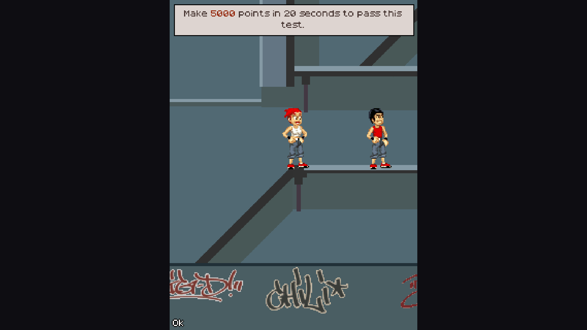

# Playman Extreme Running — Unofficial PC Remaster

**[English](#english) | [Русский](#русский)**

### [⬇ Download Ready-to-Play Game (Windows .zip)](https://github.com/Pachimari67/Playman-Extreme-Running-Remaster/releases/latest/download/Playman_Extreme_Running_Remaster_Windows.zip)

---

## English

**Playman Extreme Running (v1.0.4, 2007)** has been fully ported from Java (J2ME) to a modern engine (**Godot 4.3 C#**) for PC as an unofficial remaster.  
It runs natively on Windows without any Java emulators — just download the archive above, unpack it, and run **`Playman Extreme Running.exe`**.

### Features

- **Remaster & Original Modes (`F2`):**
  - **`Remaster` Mode**: Widescreen `16:9` view with 2x internal rendering and the original studio master WAV soundtrack by composer **Jari Pitkänen**.
  - **`Original` Mode**: Classic `240×320` phone screen and authentic **Nokia S40/S60** MIDI audio.
  - Instant real-time switching between modes via `F2` (or `Select` on a gamepad) without interrupting the music.
- **Full Keyboard & Gamepad Support:** Play using a keyboard (`WASD` / `Arrow Keys`) or any controller (`Xbox` / `DualShock` / `DualSense`).

### Controls

| Action | Keyboard | Gamepad |
| :--- | :--- | :--- |
| **Jump / Up** | `W`, `Up`, `Space` | `D-Pad Up`, Left Stick Up, `A`, `Y`, `RB` |
| **Roll / Landing / Down** | `S`, `Down` | `D-Pad Down`, Left Stick Down, `B`, `LB` |
| **Left / Right** | `A` / `D`, `Left` / `Right` | `D-Pad`, Left Stick |
| **OK / Select (in menus)** | `Enter`, `Space` | `A`, `X` |
| **Pause / Back** | `Esc` | `Start`, `B` |
| **Show / Hide Help Bar** | `F1` | — |
| **Switch `Remaster / Original` Mode** | `F2` | `Back / Select` |
| **Unlock All Levels & Missions** | `F11` | — |
| **Full Progress Reset** | `F12` | — |

---

## Русский

Классическая мобильная игра **Playman Extreme Running (v1.0.4, 2007)** была полностью перенесена со старого Java (J2ME) на новый современный движок (**Godot 4.3 C#**) для ПК в виде неофициального ремастера.  
Игра работает напрямую на Windows без каких-либо эмуляторов — просто скачайте архив по ссылке выше, распакуйте его и запустите **`Playman Extreme Running.exe`**.

### Особенности

- **Режимы `Remaster` и `Original` (`F2`):**
  - **Режим `Remaster`**: широкоэкранный вид `16:9` с 2x-рендером и оригинальным студийным WAV-саундтреком от композитора **Jari Pitkänen**.
  - **Режим `Original`**: классический экран телефона `240×320` и оригинальное MIDI-звучание **Nokia S40/S60**.
  - Мгновенное переключение между режимами по `F2` (или `Select` на геймпаде) без прерывания музыки.
- **Поддержка клавиатуры и геймпада:** полноценное управление с клавиатуры (`WASD` / `Стрелки`) и геймпадов (`Xbox` / `DualShock` / `DualSense`).

### Управление

| Действие | Клавиатура | Геймпад |
| :--- | :--- | :--- |
| **Прыжок / Вверх** | `W`, `Up`, `Space` | `D-Pad Up`, левый стик вверх, `A`, `Y`, `RB` |
| **Кувырок / Приземление / Вниз** | `S`, `Down` | `D-Pad Down`, левый стик вниз, `B`, `LB` |
| **Влево / Вправо** | `A` / `D`, `Left` / `Right` | `D-Pad`, левый стик |
| **Выбор / ОК (в меню)** | `Enter`, `Space` | `A`, `X` |
| **Пауза / Назад** | `Esc` | `Start`, `B` |
| **Скрыть / показать нижнюю панель** | `F1` | — |
| **Переключить `Remaster / Original`** | `F2` | `Back / Select` |
| **Открыть все уровни и миссии** | `F11` | — |
| **Полный сброс прогресса** | `F12` | — |
